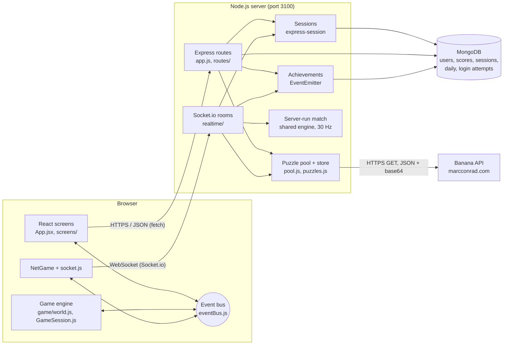

<p align="center"></p>

# Banana Brigade

A 2D jetpack shooter in the style of the classic doodle army games, built by **Sayub Shakya** for
CIS046-3 Software for Enterprise (Assignment 1). Puzzles from the
[Banana API](https://marcconrad.com/uob/banana/doc.php) by Marc Conrad are part of the game: you solve one to
deploy, to respawn, to open a banana crate, to continue a mission and to play the daily challenge.

The server (Node.js, Express, MongoDB, Socket.io) talks to the Banana API, keeps every solution, checks every
answer, owns the login sessions and runs online matches. The browser (React screens plus a canvas game engine)
only shows pictures and sends controls and answers.

## Features

- **Your sessions and your data:** see every signed-in device (device, last used) and sign one out; download
  everything stored about you as JSON.
- **Guest play:** try the game with no sign-up; a guest lasts 7 days and can be saved as a full account,
  keeping everything it earned.
- **Public pages:** a home page before login (pitch, screenshot, how the Banana puzzles work, the modes, live
  API status), Privacy and Terms, a 404 page and a "server down" screen that keeps checking `/api/status`.

- **Campaign:** 9 missions in 3 chapters (Boot Camp, Jungle Front, Banana Storm). Each mission has a kill
  target, a time limit and a number of lives. Up to 3 stars per mission. Chapters unlock with stars, and the
  server checks unlocks and stars. Bots get a little sharper every minute inside a mission.
- **Quick Play:** free-for-all against 5 bots, first to 20 kills or 5 minutes.
- **Survival:** waves of bots. A Banana puzzle is your only revive.
- **Team Battle:** 3 against 3, blue against red.
- **Training:** target dummies, not ranked.
- **Online multiplayer:** rooms with a 6-letter code or a public list, a ready check, up to 6 players, bots
  fill the empty places, and the host picks the bots' difficulty. The **server runs the match** 30 times a second; browsers only send controls.
- **Daily Banana Challenge:** the same 5 puzzles for everyone each day, 20 seconds each, one attempt a day,
  points that double for every correct answer in a row, a day streak and a daily leaderboard.
- **Achievements:** 17 badges (First Blood, Banana Brain, Speed Demon, Hard as Nails, Campaign Hero …),
  unlocked by server-side events and shown as pop-up toasts.
- **Ranks and XP:** 10 ranks from Recruit to Banana Marshal. XP comes from the record saved on the server.
- **Difficulty:** Easy, Medium or Hard before every battle. It changes how bots aim, react and fire, and how
  long each Banana puzzle lasts.
- **Avatar:** headgear, uniform, skin, goggles and beard.
- **Profile and Scores:** totals, recent games, all-time and today's leaderboards, member since, last login and
  the number of active sessions.
- **Settings** in four tabs:
  - Game: sight laser, kill-streak banners, FPS meter, fullscreen, and the Banana API health in plain words;
  - Sound: music and effects volume sliders and a mute;
  - Accessibility: high contrast, large text and reduced motion;
  - Account: change password, log out, log out everywhere, delete account, and the admin screen for admins.
- **Music and sound:** procedural menu and battle music (Web Audio, no audio files) that crossfades when a
  battle starts or ends; effects for every weapon; a chime or buzzer for each Banana answer.
- **Accounts:** register (with a live "name is free" check), log in with an optional "remember me" (30 days),
  bcrypt-hashed passwords, an HttpOnly session cookie, login limits per IP address, "forgot password" with a
  single-use reset link (30 minutes), and roles.
- **Open API:** `/api/v1` with an OpenAPI 3 file and Swagger UI at `/api/docs`, plus a public read-only
  leaderboard (`/api/v1/public/leaderboard`, CORS) that other websites can use.
- **Live event feed** (Admin → Live events): server events pushed over Socket.io as they happen.
- **Admin tools:** audit log of every admin action with its reason; suspend and restore players (signed out at
  once); Banana API health charts.
- **Admin screen:** every account with its games, kills and puzzles; reset a player's scores; promote or demote.
- **Installable (PWA):** add it to a phone's home screen or install it from Chrome; it opens offline (and says
  so), while battles, logins and puzzles still need the server.
- **Phones:** touch sticks, a fullscreen button and a "turn your phone sideways" hint.

## How the Banana API is used

| Moment | Puzzle | Rules (Medium) | Reward |
|---|---|---|---|
| Choosing a mode or mission | Deploy | 30 s, a new puzzle after a miss | You drop into the battle |
| You are down | Respawn (press **B**) | 15 s, one try | Respawn now. In Survival it is the only revive |
| Next to a banana crate (press **E**) | Crate | 20 s, one try | Choose a Banana Power (Rage, Overdrive, Bubble, Rapid Fire, Juice) |
| Campaign: out of lives | Continue | a new puzzle after a miss | One more life (costs the 2nd and 3rd stars) |
| Daily Banana Challenge | 5 daily puzzles | 20 s each | Points, streak, daily leaderboard |

Easy and Hard change the timers (for example deploy 45 s on Easy, 20 s on Hard).

How the integration works:

- Only the **server** calls the Banana API, at `api.php?out=json&base64=yes`. The PNG comes back inside the JSON,
  so one request gives both the picture and the answer.
- The server keeps the **solution** and sends the browser only `{ puzzleId, image }`. Each puzzle can be
  answered once and expires after 5 minutes.
- Each request has a **5-second timeout**. Network errors, timeouts, HTTP 5xx and 429 are **retried up to twice
  with backoff** (300 ms, then 900 ms, plus jitter); bad data and other 4xx answers are not retried.
- A pool keeps **3 puzzles ready** and a **reserve of the last 25**. If a live puzzle takes more than 2.5 s, the
  player gets a reserve puzzle. At most 3 calls run at once.
- A **circuit breaker** stops calling the API for 30 s after 3 failures in a row, serves the reserve, then lets
  one test call through.
- `GET /api/status` reports latency (last, median, average), success rate, retries used and the circuit state.
  Settings shows the same in plain words. Details: [docs/resilience.md](docs/resilience.md).
- In online matches, puzzles are fetched and answered over the **WebSocket** instead of HTTP, so the server
  knows which player solved which puzzle and applies the reward itself.

## Tech stack

| Part | Technology |
|---|---|
| Server | Node.js 22, Express 5, express-session, connect-mongo |
| Database | MongoDB with Mongoose (sessions are stored in MongoDB too) |
| Real time | Socket.io (WebSocket, with HTTP long-polling as a fallback) |
| Passwords | bcryptjs (cost 10) |
| Browser | React 19 for screens, a plain JavaScript canvas engine for the battle, Web Audio for sound and music |
| Build | Vite 8 |
| Tests | Node's built-in test runner (`node --test`) with mongodb-memory-server |
| CI | GitHub Actions (`.github/workflows/ci.yml`) |

## Setup

You need **Node.js 22 or later** and **MongoDB**.

MongoDB, either:

- local, with Homebrew on macOS:
  ```bash
  brew tap mongodb/brew && brew install mongodb-community
  brew services start mongodb-community
  ```
- or MongoDB Atlas: put your `mongodb+srv://…` address in `MONGODB_URI` in `.env`.

Then:

```bash
./run.sh            # first run: installs packages, creates .env with a random SESSION_SECRET,
                    # builds the React app, starts MongoDB if needed, then serves http://localhost:3100
./run.sh --dev      # restarts the server when files change
./run.sh --test     # runs the automated tests
```

No MongoDB installed (for example on a tutor's machine)? Run the demo instead. It starts the server with a
throw-away in-memory MongoDB (mongodb-memory-server), so nothing is saved after it stops:

```bash
npm run demo
```

Other commands:

```bash
npm run build                                # build the React app into client/dist
npm test                                     # automated tests (in-memory MongoDB, fake Banana API)
npm run create-admin -- <username> <password> # create an admin, or make a player an admin
npm run dev:client                           # Vite with hot reload on :5173, forwards /api and the socket to :3100
```

Settings live in `.env` (see `.env.example`): `PORT`, `SESSION_SECRET`, `NODE_ENV`, `MONGODB_URI`,
`BANANA_API_URL` and `BANANA_API_TIMEOUT_MS`. To show the error handling, point the API at a broken address:

```bash
BANANA_API_URL=https://marcconrad.com/uob/banana/does-not-exist.php ./run.sh
```

### Preview links

After logging in, a hash in the address opens a screen straight away (no deploy puzzle), which helps with
screenshots and the demo: `#campaign`, `#difficulty`, `#battle-quick`, `#battle-team`, `#battle-survival`,
`#battle-training`, `#mission-3`, `#puzzle-deploy`, `#puzzle-respawn`, `#puzzle-crate`, `#online`, `#daily`,
`#profile`, `#scores`, `#settings`, `#avatar`, `#controls`, `#modes`, and `#admin` (admins only).

## Controls

A / D or arrow keys: move · W or Space: jetpack · mouse: aim and fire · right click or G: grenade ·
R: reload · Q: switch weapon · F: melee · E: open a banana crate · B: Banana respawn · Z or wheel: zoom ·
Tab: scoreboard · Esc: pause. Puzzles: keys 0–9 or the keypad. On phones, touch sticks appear.

## Architecture



More detail, with sequence diagrams, is in [docs/architecture.md](docs/architecture.md).

## Project layout

Every file sits in the folder for its kind; the project root holds only config and the standard files
(README, CHANGELOG, CONTRIBUTING, package files, `run.sh`, Vite and Playwright config).

```
client/                 the browser app (React screens + canvas game)
  index.html            page shell, battle canvas and HUD markup
  public/               static files: logo, icons, screenshot, manifest, service worker (sw.js)
  src/
    App.jsx, main.jsx   screen state machine; start-up and service worker registration
    screens/            one file per screen; a folder when it has parts (Login/, Admin/)
    components/         shared UI: common.jsx (Panel, Icon, Skeleton…), Toasts, PuzzleModal, PowerPicker
    game/               the engine (world, bots, maps, weapons in config, input, auto-fire, render, sound);
                        world/bots/map/config/campaign also run on the server for online matches
    net/                Socket.io client and NetGame (draws online matches from snapshots)
    hooks/              useBus (React listens to the event bus)
    lib/                api.js (every HTTP call), eventBus.js, storage.js, rank.js, fullscreen.js, bridges
    styles/             brigade.css
server/                 Node.js + Express + MongoDB
  index.js, app.js      start-up; the Express app (middleware order, puzzle routes, static files, 404)
  config/               every setting, read from .env in one place
  routes/               one file per area: auth, scores, daily, campaign, admin, public, docs (+ openapi.js)
  services/             bananaApi, pool + puzzles (ready/reserve puzzles, circuit breaker), pwned,
                        rateLimiter, sessions, achievements, eventLog
  models/               index.js (Mongoose schemas), db.js (every database query)
  middleware/           auth.js (requireLogin, requireAdmin, suspended check)
  realtime/             socket.js (login check, admin feed), rooms.js, match.js (server-run match, 30 Hz)
tests/
  unit/                 engine and service tests (no server)
  integration/          the real app with an in-memory MongoDB (helpers.js starts it)
  e2e/                  Playwright: play.spec.js and its test server
scripts/                create-admin, demo (in-memory MongoDB), openapi-yaml
docs/                   architecture, api (+ openapi.yaml), events, evaluation, resilience, VIDEO-GUIDE, IDEAS, TASKS
```

## Security summary

- Passwords are stored only as **bcrypt hashes** (cost 10), 8–72 characters.
- The session id lives in an **HttpOnly, SameSite=Lax** cookie (`brigade.sid`), **Secure** in production,
  2-hour lifetime, or 30 days with "remember me" (off by default). Sessions are stored in MongoDB, so the
  server can end them.
- **Log out everywhere**, **change password** (needs the current one) and **delete account** (needs the password)
  end the player's other sessions and close their open WebSockets. Deleting removes the user, scores, daily
  results, failed-login records and sessions (GDPR right to erasure).
- The session id is **regenerated at login** (against session fixation).
- **Login limits per IP:** 5 wrong passwords for one name from one IP, or 20 from one IP across all names, block
  that IP for 10 minutes. A stranger cannot lock you out. Tries are counted with an atomic `$inc` before the
  password is checked, so parallel guesses cannot slip past.
- **Forgot password:** a single-use link that lasts 30 minutes. Only its SHA-256 hash is stored; using it ends
  every session of the account. In development the link is printed in the server terminal (no email needed).
  The reply is the same for unknown names, and requests are limited to 5 per IP every 15 minutes.
- New passwords are checked against **Have I Been Pwned** (k-anonymity: only 5 characters of the SHA-1 hash
  leave the server; allowed with a logged warning if the service is down).
- Login compares against a dummy hash when the user does not exist, so timing does not reveal usernames.
- **Authorisation** is checked on the server: `requireLogin`, `requireAdmin`. The user and role are read from
  the database on every request, so a deleted account or a demoted admin loses access at once. An admin cannot
  demote themselves.
- The username check (`/api/auth/available`) is limited to 20 lookups a minute.
- The WebSocket accepts **only logged-in sessions**, reusing the same cookie.
- Puzzle **solutions never reach the browser** before an answer; each puzzle can be answered once.
- Puzzle counts, campaign stars, daily scores and online match results are worked out **on the server**.
- Input is validated (username pattern, whole numbers with limits, 4 KB JSON limit, 16 KB socket messages).
  Queries are built from objects, so input cannot change a MongoDB query.
- `SESSION_SECRET` comes from `.env` (never committed); the server refuses to start in production without one.

Known limits: kills and deaths in **offline** modes come from the browser (the game runs there), so they could
be faked; online matches do not have this problem. There is no HTTPS in local development and no email
verification.

## Four themes: where to look

| Theme | What to look at | Where |
|---|---|---|
| Version control | Feature branches merged with `--no-ff`, small commits, CI | `git log --oneline --graph`, `CHANGELOG.md`, `CONTRIBUTING.md`, `.github/workflows/ci.yml` |
| Version control | Annotated release tags for each milestone: `v0.1-login`, `v0.2-gameplay`, `v0.3-mongo-react`, `v0.4-multiplayer`, `v0.5-campaign`, `v1.0.0` | `git tag -n` |
| Version control | SQLite to MongoDB swap kept in history | commits `fadda7c` and `75afbbd`; `server/models/db.js:1-4` |
| Event-driven | Browser event bus (observer pattern) | `client/src/lib/eventBus.js:9-13` |
| Event-driven | Engine emits, HUD and sound listen | `client/src/game/world.js:215`, `world.js:286`, `client/src/game/hud.js:52`, `client/src/game/sound.js:380` |
| Event-driven | React subscribes with a hook | `client/src/hooks/useBus.js:11-15`, `client/src/App.jsx:136-141` |
| Event-driven | Music crossfades on `game:state` | `client/src/game/music.js:131-136` |
| Event-driven | DOM events to bus events | `client/src/game/input.js:67-75` |
| Event-driven | Server `EventEmitter` achievements | `server/services/achievements.js:41-104` |
| Event-driven | Live event feed: server `EventEmitter` → Socket.io room `admins` → React | `server/services/eventLog.js`, `server/realtime/socket.js`, `client/src/screens/Admin/LiveEvents.jsx` |
| Event-driven | Socket.io handlers, 30 Hz timer | `server/realtime/rooms.js:143-180`, `server/realtime/match.js:150-152` |
| Interoperability | Calling the Banana API (timeout, up to 2 retries with backoff and jitter) | `server/services/bananaApi.js:91-109` (`createBananaApi` to `fetchPuzzle`) |
| Interoperability | Parsing JSON, CSV and base64 | `server/services/bananaApi.js:43-58` |
| Interoperability | Pool, reserve, deadline, circuit breaker | `server/services/pool.js:65-73`, `server/services/pool.js:136-170` |
| Interoperability | API health in `/api/status` | `server/services/pool.js:173-186` |
| Interoperability | Our own REST API for the browser | `server/app.js:106-139`, `client/src/lib/api.js:15-42` |
| Interoperability | API versioning, OpenAPI 3 + Swagger UI, public CORS leaderboard | `server/app.js` (v1 rewrite, `/api/public`), `server/routes/openapi.js`, `tests/integration/openapi.test.js` |
| Interoperability | WebSocket protocol | `server/realtime/rooms.js:9-18`, `client/src/net/socket.js:28-33` |
| Virtual identity | Session cookie settings | `server/app.js:68-80` |
| Virtual identity | Register, hash, login, per-IP limits, logout | `server/routes/auth.js:110-138`, `server/services/rateLimiter.js`, `server/models/db.js` (`bumpCounter`) |
| Virtual identity | Signed-in devices list, sign out one device, download my data | `server/services/sessions.js` (`listSessionsFor`, `endSessionByHandle`), `server/routes/auth.js` (`/sessions/:handle`, `/export`), `server/models/db.js` (`exportUser`) |
| Virtual identity | Forgot password: single-use, hashed, 30-minute reset link | `server/routes/auth.js:310-381`, `client/src/screens/Login/Login.jsx` |
| Virtual identity | Session regeneration, remember me | `server/routes/auth.js:69-86` |
| Virtual identity | Log out everywhere (`/logout-all`), change password (`/password`), delete account (`/account`), username check (`/available`), active sessions (`/sessions`) | `server/routes/auth.js:183-195`, `server/services/sessions.js:13-75` |
| Virtual identity | Authorisation middleware (user loaded from the database) | `server/middleware/auth.js:13-17` |
| Virtual identity | Suspend/restore (sessions and sockets ended, login refused) and the audit log | `server/routes/admin.js`, `server/middleware/auth.js` (suspended check), `server/models/index.js` (`AuditLog`) |
| Virtual identity | Admin roles | `server/routes/admin.js:65-85`, `client/src/screens/Admin/Admin.jsx` |
| Virtual identity | Sessions in MongoDB | `server/index.js:37-39` |
| Virtual identity | Login on the WebSocket | `server/realtime/socket.js:20-35` |

Fuller notes: [docs/events.md](docs/events.md), [docs/api.md](docs/api.md),
[docs/evaluation.md](docs/evaluation.md), [docs/VIDEO-GUIDE.md](docs/VIDEO-GUIDE.md).

## Testing

```bash
npm test          # unit and API tests (Node's test runner)
npm run build && npm run e2e   # end-to-end tests in a real browser (Playwright)
```

**End-to-end** (`tests/e2e/play.spec.js`, Playwright): a browser opens the home page, creates an account, logs out and
back in, picks Quick Play and Medium, solves the deploy puzzle and checks the battle is running; and checks the
404 page. It runs against `tests/e2e/server.js` (in-memory MongoDB, a fake Banana API whose answer is 7).
Locally it uses the installed Chrome; GitHub Actions runs it in a second CI job with Chromium.

120 unit and integration tests run on Node's built-in test runner. Each test file starts a throw-away MongoDB
(mongodb-memory-server) and a fake Banana API, and talks to the real Express and Socket.io server over HTTP.
They cover:

- puzzles: no solution in the response, one answer per puzzle, expiry, 502 on an API failure, JSON/CSV/base64
  parsing, the ready pool and the reserve, `/api/status`;
- resilience: retries only for transient failures, timeouts, normalised formats, the circuit breaker and its
  probe, the take() deadline, the in-flight limit, status statistics;
- identity: HttpOnly SameSite cookie, bcrypt hashes in the database, validation, logout, session fixation,
  per-IP login limits (including parallel guesses), password reset links (single use, expiry, hashed), login required, admin-only routes, remember me, log out everywhere (sessions and sockets), change
  password, delete account, the username check, role changes, demoted or deleted admins losing access at once;
- scores: invalid scores refused, puzzle counts taken from the server;
- campaign, achievements and the daily challenge (including two answers sent at once, and an API outage not
  using up the day's attempt);
- online play: sockets without a login are refused, rooms by code, host-only start, faked scores ignored, bot
  difficulty checked by the server.

GitHub Actions runs the tests and the Vite build on every push and pull request.

## Submitting the code

The code is submitted separately from the video. Make the zip from the committed code:

```bash
npm run package
```

It runs `git archive` on the current commit (`HEAD`), so only committed files go in. `.env`,
`node_modules/`, `data/` and `client/dist/` are left out. Unzip it, run `npm ci`, then `./run.sh` or
`npm run demo`.

## Credits

- **Banana API** by Marc Conrad, University of Bedfordshire: https://marcconrad.com/uob/banana/doc.php
- **Fonts:** Black Ops One and Rubik from Google Fonts (SIL Open Font License).
- **Libraries:** Express, express-session, connect-mongo, Mongoose and the MongoDB driver, bcryptjs, Socket.io
  and socket.io-client, React and React DOM, Vite and @vitejs/plugin-react, mongodb-memory-server.
- Gameplay and screen layout are inspired by Mini Militia Classic. All art, sounds and names in this project are
  original (drawn in code and made with Web Audio).
- Ideas such as room codes, XP ranks and the daily challenge were compared with other students' Banana API games
  (see `docs/evaluation.md`); no code was copied from them.
- The home page trailer (`client/public/media/trailer.mp4`) was generated with Google Gemini (Veo) from the prompts in
  `VIDEO-PROMPTS.md`; it is used as in-game art only and is not the assessed video.
- Code written with help from a generative AI coding assistant and reviewed by Sayub Shakya; every source file
  says so in its header comment.

_Written with help from a generative AI coding assistant; reviewed by Sayub Shakya._
