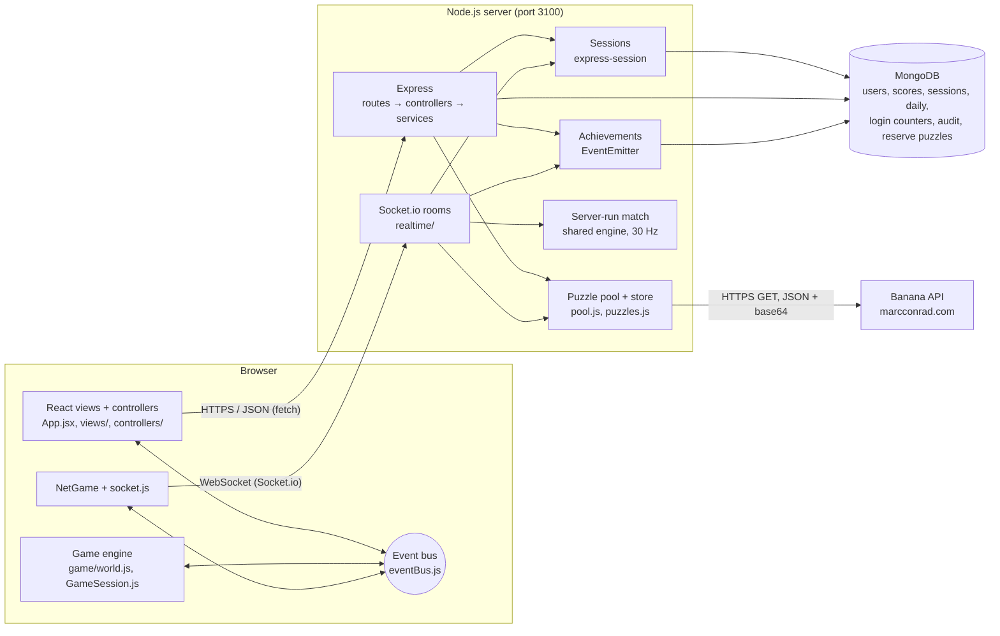

<p align="center"></p>

# Banana Brigade

A 2D jetpack shooter in the style of the classic doodle army games, built by **Sayub Shakya** for
CIS046-3 Software for Enterprise (Assignment 1). Puzzles from the
[Banana API](https://marcconrad.com/uob/banana/doc.php) by Marc Conrad are part of the game: each one is a
picture of a sum in which every banana hides the same digit, and you type that digit. You solve one to deploy,
to respawn, to open a banana crate, to continue a mission and to play the daily challenge.

The server (Node.js, Express, MongoDB, Socket.io) talks to the Banana API, keeps every solution, checks every
answer, owns the login sessions and runs online matches. The browser (React screens plus a canvas game engine)
only shows pictures and sends controls and answers.

## Features

- **Your sessions and your data:** see every signed-in device (device, last used) and sign one out; download
  everything stored about you as JSON.
- **Guest play:** try the game with no sign-up; a guest lasts 7 days and can be saved as a full account,
  keeping everything it earned.
- **Public pages:** a home page before login (pitch, screenshot, how the Banana puzzles work, the modes, live
  API status), Privacy and Terms, a 404 page and a "server down" screen that keeps checking `/api/status`.

- **Campaign:** 9 missions in 3 chapters (Boot Camp, Jungle Front, Banana Storm). Each mission has a kill
  target, a time limit and a number of lives. Up to 3 stars per mission. Chapters unlock with stars, and the
  server checks unlocks and stars. Bots get a little sharper every minute inside a mission.
- **Quick Play:** free-for-all against 5 bots, first to 20 kills in 5 minutes (or a shorter match, see below).
- **Survival:** waves of bots. A Banana puzzle is your only revive.
- **Team Battle:** 3 against 3, blue against red.
- **Training:** target dummies, not ranked.
- **Online multiplayer:** rooms with a 6-letter code or a public list, a ready check, up to 6 players, bots
  fill the empty places, and the host picks the bots' difficulty. The **server runs the match** 30 times a second; browsers only send controls.
- **Daily Banana Challenge:** the same 5 puzzles for everyone each day, 20 seconds each, one attempt a day,
  points that double for every correct answer in a row, a day streak and a daily leaderboard.
- **Achievements:** 18 badges (First Blood, Banana Brain, Speed Demon, Hard as Nails, Campaign Hero …),
  unlocked by server-side events and shown as pop-up toasts.
- **Ranks and XP:** 10 ranks from Recruit to Banana Marshal. XP comes from the record saved on the server.
- **Difficulty:** Easy, Medium or Hard before every battle. It changes how bots aim, react and fire, and how
  long each Banana puzzle lasts.
- **Avatar:** headgear, uniform, skin, goggles and face (clean, stubble, beard, moustache).
- **Profile and Scores:** totals, recent games, all-time and today's leaderboards, member since, last login and
  the number of active sessions.
- **Settings** in four tabs:
  - Game: auto-fire, sight laser, kill-streak banners, FPS meter, story clips, fullscreen, and the Banana API
    health in plain words;
  - Sound: music and effects volume sliders and a mute;
  - Accessibility: high contrast, large text and reduced motion;
  - Account: change password, log out, log out everywhere, delete account, and the admin screen for admins.
- **Music and sound:** procedural menu and battle music (Web Audio, no audio files) that crossfades when a
  battle starts or ends; effects for every weapon; a chime or buzzer for each Banana answer.
- **Accounts:** register (with a live "name is free" check), log in with an optional "remember me" (30 days),
  bcrypt-hashed passwords, an HttpOnly session cookie, login limits per name+IP and per IP, "forgot password"
  with a single-use reset link (30 minutes), and roles.
- **Open API:** `/api/v1` with an OpenAPI 3 file and Swagger UI at `/api/docs`, plus a public read-only
  leaderboard (`/api/v1/public/leaderboard`, CORS) that other websites can use.
- **Map choice:** pick Random, Jungle Ridge, Desert Outpost, Snow Peak or Night Base before Quick Play, Team Battle,
  Survival, Training or an online room (campaign missions keep their own map).
- **Match length and live score:** pick 30 s, 1, 2, 3 or 5 minutes before Quick Play, Team Battle or an online
  room (the kill target scales: a 30 s game is first to 4). A live top-5 board stays on screen, and the timer pulses
  red in the last 10 seconds.
- **Minimap and easy scope:** a radar under the player bars (you, teammates, enemies you can see, crates; M hides
  it). The sniper scope zooms in by holding the right mouse button or toggling Z, keeps you on screen and only lightly
  darkens the edges; the camera never pushes you under the HUD.
- **Banana puzzles power the game:** the server times every answer and grades it gold (<5 s), silver (<10 s) or
  bronze. Grades fill the **Banana Meter** (with a streak multiplier; a miss halves the streak); a full meter calls a
  **Supply Drop** (X) with a free choice of Banana Power. Gold deploys start with a full meter, gold respawns get a longer
  shield, gold crates offer more powers. Results show a **Banana report** (accuracy, average time, grades, live vs
  reserve puzzles).
- **Boot Camp:** a 90-second guided tutorial (move, jetpack, shoot, pick up, crate, puzzle, power) with a Skip
  button; one-time tips; H shows the controls again. New players start on Easy, which adds light aim assist
  (never online) and bots that hold fire at the start (up to 30 s).
- **Game feel and story clips:** trauma screen shake, a short hit-stop on kills, aim-leading camera, tracers,
  pickup badges, a low-fuel warning; short skippable story clips (intro, crate, chapters, victory, daily), each
  shown once, with a Settings switch.
- **Headshots and animations:** every bullet gun can headshot (gold HEADSHOT tag and pop); ragdolls, respawn
  rings, jetpack smoke, big explosions, melee/throw/reload/swap poses, multi-kill banners, low-health glow.
- **Fair online crates:** a player solving a banana-crate puzzle is protected and shown in a banana bubble until
  the window closes, then gets a 2 s shield; the server ends puzzles left open.
- **Live event feed** (Admin → Live events): server events pushed over Socket.io as they happen.
- **Admin tools:** audit log of every admin action with its reason; suspend and restore players (signed out at
  once); Banana API health charts.
- **Admin screen:** every account with its games, kills and puzzles; reset a player's scores; promote or demote.
- **Installable (PWA):** add it to a phone's home screen or install it from Chrome; it opens offline (and says
  so), while battles, logins and puzzles still need the server.
- **Phones:** touch sticks, a fullscreen button and a "turn your phone sideways" hint.

## How the Banana API is used

| Moment | Puzzle | Rules (Medium) | Reward |
|---|---|---|---|
| Choosing a mode or mission | Deploy | 30 s, a new puzzle after a miss | You drop into the battle |
| You are down | Respawn (press **B**) | 15 s, one try | Respawn now. In Survival it is the only revive |
| Next to a banana crate (press **E**) | Crate | 20 s, one try | Choose a Banana Power (Rage, Overdrive, Bubble, Rapid Fire, Juice); a faster grade gives more choices |
| Campaign: out of lives | Continue | a new puzzle after a miss | One more life (costs the 2nd and 3rd stars) |
| Daily Banana Challenge | 5 daily puzzles | 20 s each | Points, streak, daily leaderboard |

Easy and Hard change the timers (for example deploy 45 s on Easy, 20 s on Hard).

How the integration works:

- Only the **server** calls the Banana API, at `api.php?out=json&base64=yes`. The PNG comes back inside the JSON,
  so one request gives both the picture and the answer.
- The server keeps the **solution** and sends the browser only `{ puzzleId, image }`. Each puzzle can be
  answered once and expires after 5 minutes. The server also times the answer and gives the grade.
- Each request has a **5-second timeout**. Network errors, timeouts, HTTP 5xx and 429 are **retried up to twice
  with backoff** (300 ms, then 900 ms, plus jitter); bad data and other 4xx answers are not retried.
- A pool keeps **3 puzzles ready** and a **reserve of the last 25**, which is also saved in MongoDB and loaded
  when the server starts. If a live puzzle takes more than 2.5 s, the player gets a reserve puzzle. At most 3
  calls run at once.
- A **circuit breaker** stops calling the API for 30 s after 3 failures in a row, serves the reserve, then lets
  one test call through.
- `GET /api/status` reports latency (last, median, average), success rate, retries used and the circuit state.
  Settings shows the same in plain words. Details: [docs/resilience.md](docs/resilience.md).
- In online matches, puzzles are fetched and answered over the **WebSocket** instead of HTTP, so the server
  knows which player solved which puzzle and applies the reward itself.

## Tech stack

| Part | Technology |
|---|---|
| Server | Node.js 22, Express 5, express-session, connect-mongo |
| Database | MongoDB with Mongoose (sessions are stored in MongoDB too) |
| Real time | Socket.io (WebSocket, with HTTP long-polling as a fallback) |
| Passwords | bcryptjs (cost 10) |
| Browser | React 19 for screens, a plain JavaScript canvas engine for the battle, Web Audio for sound and music |
| Build | Vite 8 |
| Tests | Node's built-in test runner (`node --test`) with mongodb-memory-server |
| CI | GitHub Actions (`.github/workflows/ci.yml`) |

## Setup

You need **Node.js 22.9 or later** and **MongoDB** (or use `npm run demo`, below, which needs no MongoDB).
The first `npm install` needs internet: it downloads the packages and, for `npm run demo` and the tests, a
MongoDB binary (about 150 MB in all). While playing, the Google Fonts, the Swagger UI page (`/api/docs`) and the
Banana API itself also need internet.

MongoDB, either:

- local, with Homebrew on macOS:
  ```bash
  brew tap mongodb/brew && brew install mongodb-community
  brew services start mongodb-community
  ```
- or MongoDB Atlas: put your `mongodb+srv://…` address in `MONGODB_URI` in `.env`.

Then:

```bash
./run.sh            # first run: installs packages, creates .env with a random SESSION_SECRET,
                    # builds the React app, starts MongoDB if needed, then serves http://localhost:3100
./run.sh --dev      # restarts the server when files change
./run.sh --test     # runs the automated tests
```

No MongoDB installed (for example on a tutor's machine)? Run the demo instead. It starts the server with a
throw-away in-memory MongoDB (mongodb-memory-server), so nothing is saved after it stops:

```bash
npm run demo
```

**Windows** (no `run.sh`): in a terminal in this folder run

```bash
npm install
npm run build
npm start          # needs MongoDB; or, without MongoDB:
npm run demo
```

then open http://localhost:3100. Without a `.env` file the server picks a random session secret, so everyone is
logged out when it restarts.

Other commands:

```bash
npm run build                                # build the React app into client/dist
npm test                                     # automated tests (in-memory MongoDB, fake Banana API)
npm run create-admin -- <username> <password> # create an admin, or make a player an admin
npm run dev:client                           # Vite with hot reload on :5173, forwards /api and the socket to :3100
```

Settings live in `.env` (see `.env.example`): `PORT`, `SESSION_SECRET`, `NODE_ENV`, `MONGODB_URI`, `APP_URL`
(required in production), `BANANA_API_URL`, `BANANA_API_TIMEOUT_MS` and `PWNED_CHECK`. Every setting is read in
`server/config/index.js`. A setting given on the command line wins over `.env` (e.g. `PORT=3105 ./run.sh`).

To show the error handling, run the game normally once (it saves the last 25 Banana puzzles in MongoDB as a
reserve), then restart it with the API pointed at a broken address. `/api/status` shows the API offline and the
circuit breaker open, and every puzzle comes from the saved reserve, so the game stays playable:

```bash
BANANA_API_URL=https://marcconrad.com/uob/banana/does-not-exist.php ./run.sh
```

### Preview links

After logging in, a hash in the address opens a screen straight away (no deploy puzzle), which helps with
screenshots and the demo: `#campaign`, `#difficulty`, `#battle-quick`, `#battle-team`, `#battle-survival`,
`#battle-training`, `#bootcamp`, `#mission-3`, `#puzzle-deploy`, `#puzzle-respawn`, `#puzzle-crate`, `#power`,
`#online`, `#daily`, `#profile`, `#scores`, `#settings`, `#avatar`, `#controls`, `#modes`, and `#admin` (admins
only).

## Controls

A / D or arrow keys: move · W or Space: jetpack · mouse: aim and fire (auto-fire when aimed at an enemy) ·
G: grenade · R: reload · Q: switch weapon · F: melee · E: open a banana crate · B: Banana respawn ·
X: supply drop (full Banana Meter) · Z, hold right mouse or wheel: zoom / scope · M: minimap · H: help ·
Tab: scoreboard · Esc: pause. Puzzles: keys 0–9 or the keypad. On phones, touch sticks appear.

## Architecture



More detail, with sequence diagrams, is in [docs/architecture.md](docs/architecture.md).

## Project layout

Every file sits in the folder for its kind; the project root holds only config and the standard files
(README, CHANGELOG, CONTRIBUTING, package files, `run.sh`, Vite and Playwright config).

```
client/                 the browser app: React views + a canvas game engine (MVC style)
  index.html            page shell, battle canvas and HUD markup
  public/               static files: logo, icons, screenshot, trailer, story clips, manifest, service worker (sw.js)
  src/
    main.jsx, App.jsx   start-up; App only composes the controllers and shows the current view
    views/              one file per screen (the "V"); folders for screens with parts (Login/, Admin/)
    controllers/        React hooks holding app state and logic (the "C"): useNavigation, useAccount,
                        useSettings, useBattle, gameEngine
    components/         shared UI: common.jsx (Panel, Icon, Skeleton…), Toasts, PuzzleModal, PowerPicker,
                        BootCampCoach, Cutscene
    services/           non-React services: api.js (every HTTP call), eventBus, storage, rank, fullscreen, bridges
    hooks/              useBus (React listens to the event bus)
    game/               the engine (world, bots, maps, config, input, auto-fire, render, effects, sound,
                        music, hud, minimap, meter, tutorial); world/bots/map/config/meter/campaign also run
                        on the server
    net/                Socket.io client and NetGame (draws online matches from snapshots)
    styles/             brigade.css plus small files per feature (banana-meter, bootcamp, logo, match)
server/                 Node.js + Express + MongoDB, layered: routes → controllers → services → repositories → models
  index.js              start-up: settings, MongoDB, session store, puzzle pool, HTTP + Socket.io
  app.js                composition only: middleware order, routers, static files, 404, error handler
  config/               every setting, read from .env in one place
  routes/               URL wiring only, one file per area: auth, puzzles, scores, campaign, daily, admin,
                        public, docs, status, achievements (+ openapi.js, the API description)
  controllers/          HTTP layer: read the request, call a service, send JSON (one per area)
  services/             business rules with no req/res: auth, account, puzzle, score, campaign, daily, admin,
                        plus bananaApi, pool + puzzles (ready/reserve, circuit breaker), pwned, rateLimiter,
                        sessions, achievements, eventLog
  repositories/         data access, one per aggregate (user, score, daily, rateLimit, passwordReset, audit,
                        reservePuzzle); index.js opens the database and returns them as one `db` object
  models/               Mongoose schemas, one file per model
  middleware/           auth (requireLogin, requireAdmin), apiVersion (/api/v1), session, cors, lastSeen,
                        notFound, errorHandler
  lib/                  small helpers: AppError, the HTTP session helpers, device names
  realtime/             socket.js (login check, admin feed), rooms.js, match.js (server-run match, 30 Hz)
tests/
  unit/                 engine and service tests (no server)
  integration/          the real app with an in-memory MongoDB (helpers.js starts it)
  e2e/                  Playwright: play.spec.js and its test server
scripts/                create-admin, demo (in-memory MongoDB), openapi-yaml
docs/                   architecture, api (+ openapi.yaml), events, evaluation, resilience, VIDEO-GUIDE, IDEAS, TASKS
```

## Security summary

- Passwords are stored only as **bcrypt hashes** (cost 10), 8–72 characters.
- The session id lives in an **HttpOnly, SameSite=Lax** cookie (`brigade.sid`), **Secure** in production,
  2-hour lifetime, or 30 days with "remember me" (off by default). Sessions are stored in MongoDB, so the
  server can end them.
- **Log out everywhere**, **change password** (needs the current one) and **delete account** (needs the password)
  end the player's other sessions and close their open WebSockets. Deleting removes the user, scores, daily
  results, failed-login records and sessions (GDPR right to erasure).
- The session id is **regenerated at login** (against session fixation).
- **Login limits per name+IP and per IP:** 5 wrong passwords for one name from one IP, or 20 from one IP across
  all names, block that IP for 10 minutes. There is no per-username lockout, so a stranger cannot lock you out.
  Tries are counted with an atomic `$inc` before the password is checked, so parallel guesses cannot slip past.
- **Forgot password:** a single-use link that lasts 30 minutes. Only its SHA-256 hash is stored; using it ends
  every session of the account. In development the link is printed in the server terminal (no email needed).
  The reply is the same for unknown names, and requests are limited to 5 per IP every 15 minutes.
- New passwords are checked against **Have I Been Pwned** (k-anonymity: only 5 characters of the SHA-1 hash
  leave the server; allowed with a logged warning if the service is down).
- Login compares against a dummy hash when the user does not exist, so timing does not reveal usernames.
- **Authorisation** is checked on the server: `requireLogin`, `requireAdmin`. The user and role are read from
  the database on every request, so a deleted account or a demoted admin loses access at once. An admin cannot
  demote themselves.
- The username check (`/api/auth/available`) is limited to 20 lookups a minute.
- The WebSocket accepts **only logged-in sessions**, reusing the same cookie.
- Puzzle **solutions never reach the browser** before an answer; each puzzle can be answered once.
- Puzzle counts, campaign stars, daily scores and online match results are worked out **on the server**.
- Input is validated (username pattern, whole numbers with limits, 4 KB JSON limit, 16 KB socket messages).
  Queries are built from objects, so input cannot change a MongoDB query.
- `SESSION_SECRET` comes from `.env` (never committed); the server refuses to start in production without one.

Known limits: kills and deaths in **offline** modes come from the browser (the game runs there), so they could
be faked; online matches do not have this problem. There is no HTTPS in local development and no email
verification.

## Four themes: where to look

| Theme | What to look at | Where |
|---|---|---|
| Version control | Feature branches merged with `--no-ff`, small commits, CI | `git log --oneline --graph`, `CHANGELOG.md`, `CONTRIBUTING.md`, `.github/workflows/ci.yml` |
| Version control | Annotated release tags for each milestone: `v0.1-login`, `v0.2-gameplay`, `v0.3-mongo-react`, `v0.4-multiplayer`, `v0.5-campaign`, `v1.0.0` … `v1.3.2` | `git tag -n` |
| Version control | SQLite to MongoDB swap kept in history | commits `fadda7c` and `75afbbd` (then `server/db.js`, today `server/repositories/`) |
| Event-driven | Browser event bus (observer pattern) | `client/src/services/eventBus.js:3-23` |
| Event-driven | Engine emits, HUD and sound listen | `client/src/game/world.js:206`, `client/src/game/world.js:305`, `client/src/game/hud.js:76`, `client/src/game/sound.js:343` |
| Event-driven | React subscribes with a hook | `client/src/hooks/useBus.js:6-10`, `client/src/controllers/useBattle.js:45-55` |
| Event-driven | Music crossfades on `game:state` | `client/src/game/music.js:124-127` |
| Event-driven | DOM events to bus events | `client/src/game/input.js:120-134` |
| Event-driven | Banana Meter and supply drop: answer → meter → X → drop | `client/src/game/GameSession.js:64-92`, `client/src/game/world.js:224-250`, `client/src/game/hud.js:102-107` |
| Event-driven | Boot Camp driven by bus events | `client/src/game/tutorial.js:26`, `client/src/game/tutorial.js:83-100` |
| Event-driven | Server `EventEmitter` achievements | `server/services/achievements.js:32-100` |
| Event-driven | Live event feed: server `EventEmitter` → Socket.io room `admins` → React | `server/services/eventLog.js:14-44`, `server/realtime/socket.js:29-38`, `client/src/views/Admin/LiveEvents.jsx` |
| Event-driven | Socket.io handlers, 30 Hz timer | `server/realtime/rooms.js:124-247`, `server/realtime/match.js:166-168` |
| Interoperability | Calling the Banana API (timeout, up to 2 retries with backoff and jitter) | `server/services/bananaApi.js:62-126` (`createBananaApi` to `fetchPuzzle`) |
| Interoperability | Parsing JSON, CSV and base64 | `server/services/bananaApi.js:18-54` |
| Interoperability | Pool, reserve, deadline, circuit breaker | `server/services/pool.js:51-58`, `server/services/pool.js:116-146` |
| Interoperability | Reserve saved in MongoDB and loaded at start-up | `server/services/pool.js:33-44`, `server/index.js:35-40`, `server/repositories/reservePuzzleRepository.js` |
| Interoperability | API health in `/api/status` | `server/services/pool.js:148-161` |
| Interoperability | Our own REST API for the browser (server-timed grade) | `server/services/puzzleService.js:7-32`, `server/services/puzzles.js:5-36`, `server/controllers/puzzleController.js`, `client/src/services/api.js:7-30` |
| Interoperability | API versioning, OpenAPI 3 + Swagger UI, public CORS leaderboard | `server/middleware/apiVersion.js:3-6`, `server/app.js:56-57`, `server/routes/openapi.js`, `tests/integration/openapi.test.js` |
| Interoperability | WebSocket protocol | `docs/api.md` (Socket.io protocol), `server/realtime/rooms.js`, `client/src/net/socket.js:22-28` |
| Virtual identity | Session cookie settings | `server/middleware/session.js:7-21` |
| Virtual identity | Register, hash, login, limits per name+IP and per IP, logout | `server/routes/auth.js:9-11`, `server/services/authService.js:34-38`, `:53-101`, `server/services/rateLimiter.js:16-34`, `server/repositories/rateLimitRepository.js:5-19` (`bumpCounter`) |
| Virtual identity | Signed-in devices list, sign out one device, download my data | `server/services/sessions.js` (`listSessionsFor`, `endSessionByHandle`), `server/routes/auth.js:21-23`, `server/services/accountService.js`, `server/repositories/userRepository.js` (`exportUser`) |
| Virtual identity | Forgot password: single-use, hashed, 30-minute reset link | `server/services/authService.js:166-202`, `client/src/views/Login/Login.jsx` |
| Virtual identity | Session regeneration, remember me | `server/lib/httpSession.js:7-23` |
| Virtual identity | Log out everywhere (`/logout-all`), change password (`/password`), delete account (`/account`), username check (`/available`), active sessions (`/sessions`) | `server/services/authService.js:103-126`, `:204-213`, `server/services/sessions.js:5-70` |
| Virtual identity | Authorisation middleware (user loaded from the database) | `server/middleware/auth.js:3-42` |
| Virtual identity | Suspend/restore (sessions and sockets ended, login refused) and the audit log | `server/routes/admin.js`, `server/services/adminService.js:55-75`, `server/middleware/auth.js:15-20` (suspended check), `server/models/auditLog.js` |
| Virtual identity | Admin roles | `server/services/adminService.js:43-53`, `client/src/views/Admin/Admin.jsx` |
| Virtual identity | Sessions in MongoDB | `server/index.js:31-33` |
| Virtual identity | Login on the WebSocket | `server/realtime/socket.js:14-25` |

Fuller notes: [docs/events.md](docs/events.md), [docs/api.md](docs/api.md),
[docs/evaluation.md](docs/evaluation.md), [docs/VIDEO-GUIDE.md](docs/VIDEO-GUIDE.md).

## Testing

```bash
npm test          # unit and API tests (Node's test runner)
npm run build && npm run e2e   # end-to-end tests in a real browser (Playwright)
```

**End-to-end** (`tests/e2e/play.spec.js`, Playwright): a browser opens the home page, creates an account, logs out and
back in, picks Quick Play and Medium, solves the deploy puzzle and checks the battle is running; and checks the
404 page. It runs against `tests/e2e/server.js` (in-memory MongoDB, a fake Banana API whose answer is 7).
Locally it uses the installed Chrome; GitHub Actions runs it in a second CI job with Chromium.

193 unit and integration tests run on Node's built-in test runner. The unit tests check the engine and services
on their own; each integration test file starts a throw-away MongoDB (mongodb-memory-server) and a fake Banana
API, and talks to the real Express and Socket.io server over HTTP. They cover:

- puzzles: no solution in the response, one answer per puzzle, expiry, 502 on an API failure, JSON/CSV/base64
  parsing, the ready pool and the reserve, `/api/status`;
- resilience: retries only for transient failures, timeouts, normalised formats, the circuit breaker and its
  probe, the take() deadline, the in-flight limit, status statistics;
- identity: HttpOnly SameSite cookie, bcrypt hashes in the database, validation, logout, session fixation,
  per-IP login limits (including parallel guesses), password reset links (single use, expiry, hashed), login required, admin-only routes, remember me, log out everywhere (sessions and sockets), change
  password, delete account, the username check, role changes, demoted or deleted admins losing access at once;
- scores: invalid scores refused, puzzle counts taken from the server;
- campaign, achievements and the daily challenge (including two answers sent at once, and an API outage not
  using up the day's attempt);
- online play: sockets without a login are refused, rooms by code, host-only start, faked scores ignored, bot
  difficulty and match length checked by the server, fair crates (protection, time-out, cooldown);
- gameplay: physics, weapons, headshots, maps, Banana Powers, the Banana Meter and grades, Boot Camp steps, match
  lengths, the minimap, zoom and camera, auto-fire and bot difficulty.

GitHub Actions runs the tests and the Vite build on every push and pull request.

## Submitting the code

The code is submitted separately from the video. Make the zip from the committed code:

```bash
npm run package
```

It runs `git archive` on the current commit (`HEAD`), so only committed files go in. `.env`,
`node_modules/`, `data/` and `client/dist/` are left out. Unzip it, run `npm ci`, then `./run.sh` or
`npm run demo`.

## Credits

- **Banana API** by Marc Conrad, University of Bedfordshire: https://marcconrad.com/uob/banana/doc.php
- **Music:** the menu theme "Goggles Down, Engines Up" and the battle track "Sunday Morning Maneuvers" were made
  with Google Gemini (music generation) from my own prompts.
- **Gun sounds:** pistol, rifle, SMG, shotgun and sniper shots are cut from "Gunshot Sounds" by Vincent Sevedge
  (Tabasco) on OpenGameArt.org (https://opengameart.org/content/gunshot-sounds), listed as CC0 and marked CC-BY 3.0
  in the download (credited here either way). Rocket, flamethrower and all other sounds are made in code with Web Audio.
- **Fonts:** Black Ops One and Rubik from Google Fonts (SIL Open Font License).
- **Libraries:** Express, express-session, connect-mongo, Mongoose and the MongoDB driver, bcryptjs, Socket.io
  and socket.io-client, React and React DOM, Vite and @vitejs/plugin-react, mongodb-memory-server, Playwright
  (end-to-end tests) and Swagger UI (the `/api/docs` page, loaded from a CDN).
- Gameplay and screen layout are inspired by Mini Militia Classic. The in-game art, sounds and names are original
  (drawn in code and made with Web Audio); the only exceptions are the gun shot recordings (above) and the home-page
  trailer, its poster and the story clips cut from it (below).
- Ideas such as room codes, XP ranks and the daily challenge were compared with other students' Banana API games
  (see `docs/evaluation.md`); no code was copied from them.
- The home page trailer (`client/public/media/trailer.mp4`, about 1 minute, "Crack the Code") joins clips generated
  with Google Flow (Veo / Omni) from my own prompts, screen recordings of the real game (a Banana API puzzle and a
  battle) and title cards made from the game's fonts and logo. Its music, "Goggles Down, Engines Up", was made with
  Google Gemini (music generation) from my own prompt; the sound is the clips' own generated audio plus
  effects: the CC0/CC-BY gun shots above and click, chime, whoosh and impact sounds synthesised with ffmpeg. It is
  in-game art only and not the assessed video.
  The story clips in `client/public/media/clips/` (videos and poster frames) are short cuts from the clips
  generated with Google Flow.
- Code written with help from Claude (Anthropic), an AI coding assistant, and reviewed by Sayub Shakya; every
  source file says so in its one-line header comment.

_Written with help from Claude (Anthropic), an AI coding assistant; reviewed by Sayub Shakya._
