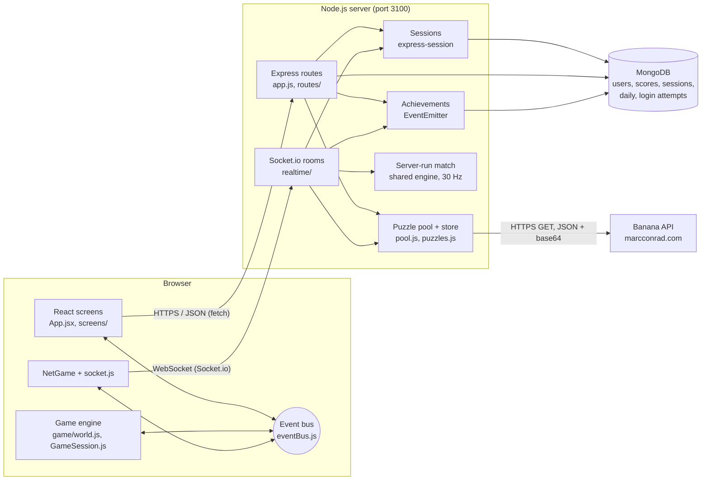

# Banana Brigade

A 2D jetpack shooter in the style of the classic doodle army games, built by **Sayub Shakya** for
CIS046-3 Software for Enterprise (Assignment 1). Puzzles from the
[Banana API](https://marcconrad.com/uob/banana/doc.php) by Marc Conrad are part of the game: you solve one to
deploy, to respawn, to open a banana crate, to continue a mission and to play the daily challenge.

The server (Node.js, Express, MongoDB, Socket.io) talks to the Banana API, keeps every solution, checks every
answer, owns the login sessions and runs online matches. The browser (React screens plus a canvas game engine)
only shows pictures and sends controls and answers.

## Features

- **Campaign:** 9 missions in 3 chapters (Boot Camp, Jungle Front, Banana Storm). Each mission has a kill
  target, a time limit and a number of lives. Up to 3 stars per mission. Chapters unlock with stars, and the
  server checks unlocks and stars. Bots get a little sharper every minute inside a mission.
- **Quick Play:** free-for-all against 5 bots, first to 20 kills or 5 minutes.
- **Survival:** waves of bots. A Banana puzzle is your only revive.
- **Team Battle:** 3 against 3, blue against red.
- **Training:** target dummies, not ranked.
- **Online multiplayer:** rooms with a 6-letter code or a public list, a ready check, up to 6 players, bots
  fill the empty places. The **server runs the match** 30 times a second; browsers only send controls.
- **Daily Banana Challenge:** the same 5 puzzles for everyone each day, 20 seconds each, one attempt a day,
  points that double for every correct answer in a row, a day streak and a daily leaderboard.
- **Achievements:** 17 badges (First Blood, Banana Brain, Speed Demon, Hard as Nails, Campaign Hero …),
  unlocked by server-side events and shown as pop-up toasts.
- **Ranks and XP:** 10 ranks from Recruit to Banana Marshal. XP comes from the record saved on the server.
- **Difficulty:** Easy, Medium or Hard before every battle. It changes how bots aim, react and fire, and how
  long each Banana puzzle lasts.
- **Avatar:** headgear, uniform, skin, goggles and beard.
- **Profile, Scores and Settings:** totals, recent games, all-time and today's leaderboards, sound, sight
  laser, kill-streak banners and an FPS meter.
- **Accounts:** register, log in, log out, bcrypt-hashed passwords, an HttpOnly session cookie, a lockout after
  5 wrong passwords, and an admin role.

## How the Banana API is used

| Moment | Puzzle | Rules (Medium) | Reward |
|---|---|---|---|
| Choosing a mode or mission | Deploy | 30 s, a new puzzle after a miss | You drop into the battle |
| You are down | Respawn (press **B**) | 15 s, one try | Respawn now. In Survival it is the only revive |
| Next to a banana crate (press **E**) | Crate | 20 s, one try | A power weapon, full health, +2 grenades |
| Campaign: out of lives | Continue | a new puzzle after a miss | One more life (costs the 2nd and 3rd stars) |
| Daily Banana Challenge | 5 daily puzzles | 20 s each | Points, streak, daily leaderboard |

Easy and Hard change the timers (for example deploy 45 s on Easy, 20 s on Hard).

How the integration works:

- Only the **server** calls the Banana API, at `api.php?out=json&base64=yes`. The PNG comes back inside the JSON,
  so one request gives both the picture and the answer.
- The server keeps the **solution** and sends the browser only `{ puzzleId, image }`. Each puzzle can be
  answered once and expires after 5 minutes.
- Each request has a **5-second timeout** and one retry. A pool keeps **3 puzzles ready** and a **reserve of the
  last 25**, so the game keeps working if the API stops answering. `GET /api/status` reports the state.
- In online matches, puzzles are fetched and answered over the **WebSocket** instead of HTTP, so the server
  knows which player solved which puzzle and applies the reward itself.

## Tech stack

| Part | Technology |
|---|---|
| Server | Node.js 22, Express 5, express-session, connect-mongo |
| Database | MongoDB with Mongoose (sessions are stored in MongoDB too) |
| Real time | Socket.io (WebSocket, with HTTP long-polling as a fallback) |
| Passwords | bcryptjs (cost 10) |
| Browser | React 19 for screens, a plain JavaScript canvas engine for the battle, Web Audio for sound |
| Build | Vite 8 |
| Tests | Node's built-in test runner (`node --test`) with mongodb-memory-server |
| CI | GitHub Actions (`.github/workflows/ci.yml`) |

## Setup

You need **Node.js 22 or later** and **MongoDB**.

MongoDB, either:

- local, with Homebrew on macOS:
  ```bash
  brew tap mongodb/brew && brew install mongodb-community
  brew services start mongodb-community
  ```
- or MongoDB Atlas: put your `mongodb+srv://…` address in `MONGODB_URI` in `.env`.

Then:

```bash
./run.sh            # first run: installs packages, creates .env with a random SESSION_SECRET,
                    # builds the React app, starts MongoDB if needed, then serves http://localhost:3100
./run.sh --dev      # restarts the server when files change
./run.sh --test     # runs the automated tests
```

No MongoDB installed (for example on a tutor's machine)? Run the demo instead. It starts the server with a
throw-away in-memory MongoDB (mongodb-memory-server), so nothing is saved after it stops:

```bash
npm run demo
```

Other commands:

```bash
npm run build                                # build the React app into client/dist
npm test                                     # automated tests (in-memory MongoDB, fake Banana API)
npm run create-admin -- <username> <password> # create an admin, or make a player an admin
npm run dev:client                           # Vite with hot reload on :5173, forwards /api and the socket to :3100
```

Settings live in `.env` (see `.env.example`): `PORT`, `SESSION_SECRET`, `NODE_ENV`, `MONGODB_URI`,
`BANANA_API_URL` and `BANANA_API_TIMEOUT_MS`. To show the error handling, point the API at a broken address:

```bash
BANANA_API_URL=https://marcconrad.com/uob/banana/does-not-exist.php ./run.sh
```

### Preview links

After logging in, a hash in the address opens a screen straight away (no deploy puzzle), which helps with
screenshots and the demo: `#campaign`, `#difficulty`, `#battle-quick`, `#battle-team`, `#battle-survival`,
`#battle-training`, `#mission-3`, `#puzzle-deploy`, `#puzzle-respawn`, `#puzzle-crate`, `#online`, `#daily`,
`#profile`, `#scores`, `#settings`, `#avatar`, `#controls`, `#modes`.

## Controls

A / D or arrow keys: move · W or Space: jetpack · mouse: aim and fire · right click or G: grenade ·
R: reload · Q: switch weapon · F: melee · E: open a banana crate · B: Banana respawn · Z or wheel: zoom ·
Tab: scoreboard · Esc: pause. Puzzles: keys 0–9 or the keypad. On phones, touch sticks appear.

## Architecture



More detail, with sequence diagrams, is in [docs/architecture.md](docs/architecture.md).

## Project layout

| Path | What it holds |
|---|---|
| `server/index.js` | Entry point: reads `.env`, connects to MongoDB, starts HTTP and Socket.io |
| `server/app.js` | Express app: session cookie, puzzle routes, status, static files |
| `server/routes/` | `auth.js` (register, login, logout, me), `scores.js`, `campaign.js`, `daily.js`, `admin.js` |
| `server/middleware/auth.js` | `requireLogin` and `requireAdmin` |
| `server/db.js`, `server/models.js` | All database access and the Mongoose schemas |
| `server/services/bananaApi.js` | The only code that calls the Banana API (timeout, retry, parsing) |
| `server/pool.js`, `server/puzzles.js` | Ready puzzles and reserve; solutions kept on the server |
| `server/achievements.js` | Event-driven achievements (Node `EventEmitter`) |
| `server/realtime/` | `socket.js` (login check), `rooms.js` (rooms, puzzles), `match.js` (server-run match) |
| `client/src/App.jsx` | Screen state machine and the hand-over to battles |
| `client/src/eventBus.js`, `hooks.js` | Publish/subscribe bus and the React `useBus` hook |
| `client/src/api.js`, `net/socket.js` | Every HTTP call and the WebSocket connection |
| `client/src/game/` | Engine shared by browser and server: `world.js`, `bots.js`, `map.js`, `config.js`, `campaign.js`; browser-only `GameSession.js`, `render.js`, `hud.js`, `input.js`, `sound.js` |
| `client/src/net/NetGame.js` | Draws online matches from server snapshots |
| `client/src/screens/` | React screens, including `PuzzleModal.jsx` |
| `scripts/create-admin.js` | Command-line admin creation |
| `tests/` | Automated tests |
| `docs/` | Architecture, events, API, evaluation, ideas, video guide |

## Security summary

- Passwords are stored only as **bcrypt hashes** (cost 10), 8–72 characters.
- The session id lives in an **HttpOnly, SameSite=Lax** cookie (`brigade.sid`), **Secure** in production,
  2-hour lifetime. Sessions are stored in MongoDB, so the server can end them.
- The session id is **regenerated at login** (against session fixation).
- **Lockout:** 5 wrong passwords lock the name for 10 minutes (MongoDB TTL index clears old attempts).
- Login compares against a dummy hash when the user does not exist, so timing does not reveal usernames.
- **Authorisation** is checked on the server: `requireLogin`, `requireAdmin` (role from the session).
- The WebSocket accepts **only logged-in sessions**, reusing the same cookie.
- Puzzle **solutions never reach the browser** before an answer; each puzzle can be answered once.
- Puzzle counts, campaign stars, daily scores and online match results are worked out **on the server**.
- Input is validated (username pattern, whole numbers with limits, 4 KB JSON limit, 16 KB socket messages).
  Queries are built from objects, so input cannot change a MongoDB query.
- `SESSION_SECRET` comes from `.env` (never committed); the server refuses to start in production without one.

Known limits: kills and deaths in **offline** modes come from the browser (the game runs there), so they could
be faked; online matches do not have this problem. There is no HTTPS in local development and no email
verification.

## Four themes: where to look

| Theme | What to look at | Where |
|---|---|---|
| Version control | Feature branches merged with `--no-ff`, small commits, CI | `git log --oneline --graph`, `CHANGELOG.md`, `CONTRIBUTING.md`, `.github/workflows/ci.yml` |
| Version control | SQLite to MongoDB swap kept in history | commits `fadda7c` and `75afbbd`; `server/db.js:1-4` |
| Event-driven | Browser event bus (observer pattern) | `client/src/eventBus.js:9-28` |
| Event-driven | Engine emits, HUD and sound listen | `client/src/game/world.js:195`, `world.js:245`, `client/src/game/hud.js:50`, `client/src/game/sound.js:74` |
| Event-driven | React subscribes with a hook | `client/src/hooks.js:11-15`, `client/src/App.jsx:75-80` |
| Event-driven | DOM events to bus events | `client/src/game/input.js:62-70` |
| Event-driven | Server `EventEmitter` achievements | `server/achievements.js:36-94` |
| Event-driven | Socket.io handlers, 30 Hz timer | `server/realtime/rooms.js:137-250`, `server/realtime/match.js:129-131` |
| Interoperability | Calling the Banana API (timeout, retry) | `server/services/bananaApi.js:68-84` |
| Interoperability | Parsing JSON, CSV and base64 | `server/services/bananaApi.js:23-57` |
| Interoperability | Pool and reserve | `server/pool.js:52-68` |
| Interoperability | Our own REST API for the browser | `server/app.js:78-111`, `client/src/api.js:9-19` |
| Interoperability | WebSocket protocol | `server/realtime/rooms.js:9-18`, `client/src/net/socket.js:25-30` |
| Virtual identity | Session cookie settings | `server/app.js:47-59` |
| Virtual identity | Register, hash, login, lockout, logout | `server/routes/auth.js:41-104` |
| Virtual identity | Session regeneration | `server/routes/auth.js:25-36` |
| Virtual identity | Authorisation middleware | `server/middleware/auth.js:7-16` |
| Virtual identity | Sessions in MongoDB | `server/index.js:45-47` |
| Virtual identity | Login on the WebSocket | `server/realtime/socket.js:20-27` |

Fuller notes: [docs/events.md](docs/events.md), [docs/api.md](docs/api.md),
[docs/evaluation.md](docs/evaluation.md), [docs/VIDEO-GUIDE.md](docs/VIDEO-GUIDE.md).

## Testing

```bash
npm test
```

29 tests run on Node's built-in test runner. Each test file starts a throw-away MongoDB
(mongodb-memory-server) and a fake Banana API, and talks to the real Express and Socket.io server over HTTP.
They cover:

- puzzles: no solution in the response, one answer per puzzle, expiry, 502 on an API failure, JSON/CSV/base64
  parsing, the ready pool and the reserve, `/api/status`;
- identity: HttpOnly SameSite cookie, bcrypt hashes in the database, validation, logout, session fixation,
  lockout, login required, admin-only routes;
- scores: invalid scores refused, puzzle counts taken from the server;
- campaign, achievements and the daily challenge;
- online play: sockets without a login are refused, rooms by code, host-only start, faked scores ignored.

GitHub Actions runs the tests and the Vite build on every push and pull request.

## Submitting the code

The code is submitted separately from the video. Make the zip from the committed code:

```bash
npm run package
```

It runs `git archive` on the current commit (`HEAD`), so only committed files go in. `.env`,
`node_modules/`, `data/` and `client/dist/` are left out. Unzip it, run `npm ci`, then `./run.sh` or
`npm run demo`.

## Credits

- **Banana API** by Marc Conrad, University of Bedfordshire: https://marcconrad.com/uob/banana/doc.php
- **Fonts:** Black Ops One and Rubik from Google Fonts (SIL Open Font License).
- **Libraries:** Express, express-session, connect-mongo, Mongoose and the MongoDB driver, bcryptjs, Socket.io
  and socket.io-client, React and React DOM, Vite and @vitejs/plugin-react, mongodb-memory-server.
- Gameplay and screen layout are inspired by Mini Militia Classic. All art, sounds and names in this project are
  original (drawn in code and made with Web Audio).
- Ideas such as room codes, XP ranks and the daily challenge were compared with other students' Banana API games
  (see `docs/evaluation.md`); no code was copied from them.
- Code written with help from a generative AI coding assistant and reviewed by Sayub Shakya; every source file
  says so in its header comment.

_Written with help from a generative AI coding assistant; reviewed by Sayub Shakya._
