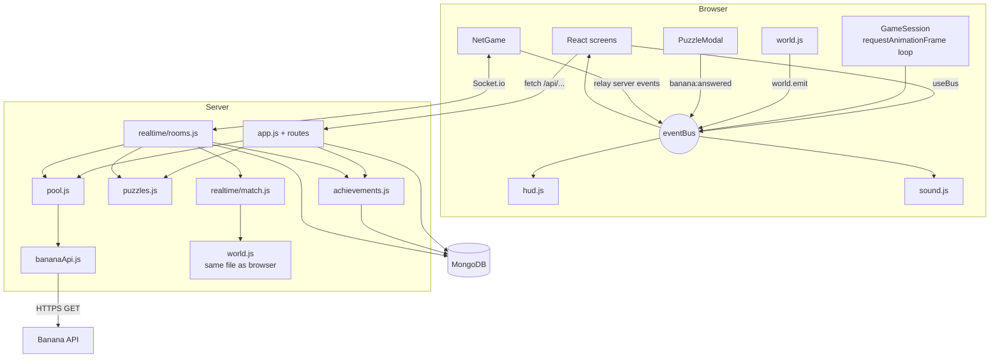
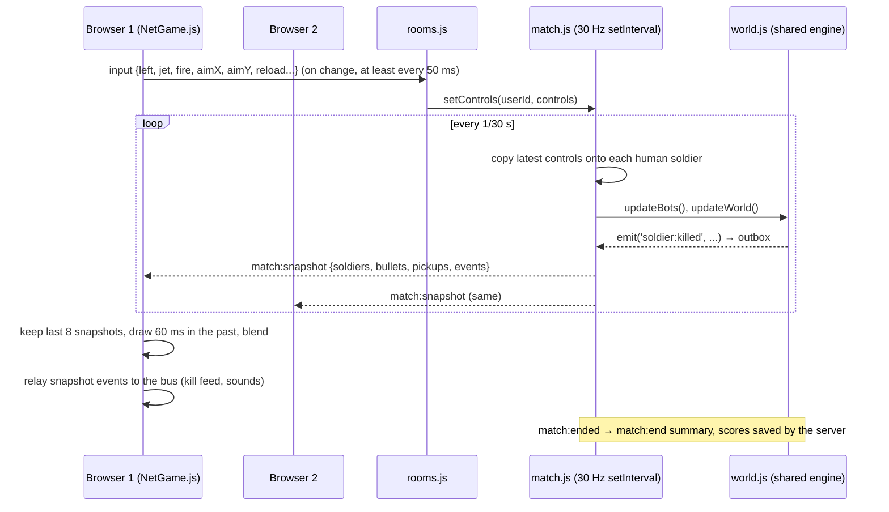

# Architecture

Banana Brigade is a distributed system with four parts:

1. **The browser**: React screens, a canvas game engine and an event bus.
2. **Our Node.js server**: Express for HTTP/JSON, Socket.io for WebSockets, sessions, puzzles, achievements
   and server-run online matches.
3. **MongoDB**: players, scores, sessions, failed logins and the daily challenge.
4. **The Banana API** by Marc Conrad: a third-party service on another server that we do not control.

The browser never talks to MongoDB or to the Banana API. Everything goes through our server.

## Components

| Component | Files | Job |
|---|---|---|
| Entry point | `server/index.js` | Reads `.env`, connects to MongoDB, creates the session store, starts HTTP and Socket.io on one port |
| Express app | `server/app.js` | Session cookie, JSON body limit, routers, puzzle routes, `/api/status`, static files |
| Routers | `server/routes/auth.js`, `scores.js`, `campaign.js`, `daily.js`, `admin.js` | Accounts, results, campaign progress, daily challenge, admin tools |
| Access checks | `server/middleware/auth.js` | `requireLogin`, `requireAdmin`; load the user and role from the database on every request |
| Session tools | `server/sessions.js` | Find and end every session of one player; close their open sockets |
| Storage | `server/db.js`, `server/models.js` | Every database query, and the Mongoose schemas |
| Banana API client | `server/services/bananaApi.js` | The only file that calls the external API: timeout, up to 2 retries with backoff, parsing, call statistics |
| Puzzle pool | `server/pool.js` | 3 ready puzzles, a reserve of 25, a 2.5 s deadline, at most 3 calls in flight, a circuit breaker, `/api/status` numbers |
| Puzzle store | `server/puzzles.js` | Solutions by `puzzleId`; one answer each; 5-minute expiry |
| Achievements | `server/achievements.js` | Rules that listen for game events and unlock badges |
| Realtime | `server/realtime/socket.js`, `rooms.js`, `match.js` | Logged-in sockets only; rooms; matches run on the server |
| Shared engine | `client/src/game/world.js`, `bots.js`, `map.js`, `config.js`, `campaign.js` | Used by the browser **and** the server (`match.js`, `routes/campaign.js`) |
| Screens | `client/src/App.jsx`, `client/src/screens/*.jsx` | React screen state machine, including Settings (four tabs) and the Admin screen |
| Sound and music | `client/src/game/sound.js`, `music.js` | Effects and procedural music on separate volume buses, driven by bus events |
| Phone and accessibility | `client/src/fullscreen.js`, `a11y-*` classes in `styles/brigade.css` | Fullscreen, rotate hint, high contrast, large text, reduced motion |
| Demo | `scripts/demo.js` | `npm run demo`: the server with an in-memory MongoDB |
| Battle loop | `client/src/game/GameSession.js` | Fixed 1/60 s steps: input, bots, world, renderer, HUD |
| Online view | `client/src/net/NetGame.js`, `net/socket.js` | Sends controls; draws server snapshots with blending |
| Glue | `client/src/eventBus.js`, `hooks.js`, `puzzleBridge.js`, `api.js` | Event bus, React hook, puzzle window opener, HTTP calls |



## Data flow

- **Puzzles:** Banana API → `bananaApi.js` (parse, check) → `pool.js` (ready / reserve) → `puzzles.js` keeps the
  solution → the browser gets `{ puzzleId, image }` → the browser sends `{ puzzleId, answer }` → the server
  checks it, counts it in the session and fires `puzzle:answered` for achievements.
- **Identity:** login → bcrypt check → new session saved in MongoDB → `brigade.sid` cookie. Every HTTP request
  and the WebSocket handshake carry the cookie; the server reads `userId` from the session and loads the user
  (with their current role) from the database. Logging out everywhere, changing the password or deleting the
  account ends the player's sessions in MongoDB and closes their sockets.
- **Offline battles:** the game runs in the browser. At the end, the browser sends kills, deaths and time; the
  server adds the puzzle counts from the session and saves the score.
- **Online battles:** the server runs the world. Browsers send only controls; the server sends snapshots and
  saves the results itself.

## Sequence: login and session

```mermaid
sequenceDiagram
  participant B as Browser (Login.jsx, api.js)
  participant S as Server (routes/auth.js)
  participant D as MongoDB
  B->>S: POST /api/auth/login {username, password}
  S->>D: count failed logins in the last 10 min
  alt 5 or more
    S-->>B: 429 Too many failed attempts
  end
  S->>D: find user (case-insensitive)
  S->>S: bcrypt.compare(password, hash or dummy hash)
  alt wrong
    S->>D: record failed login (TTL 10 min)
    S-->>B: 401 Wrong username or password (n tries left)
  else right
    S->>D: clear failed logins, set lastLoginAt
    S->>S: req.session.regenerate() (new id)
    S->>D: save session {userId, username, role, puzzles, createdAt}
    S-->>B: 200 {user} + Set-Cookie brigade.sid (HttpOnly, SameSite=Lax; 2 h, or 30 days with remember me)
  end
  B->>S: GET /api/auth/me (cookie sent automatically)
  S->>D: load session by id, then the user by userId
  S-->>B: {user, puzzles}
  B->>S: POST /api/auth/logout-all
  S->>D: delete every session with this userId
  S->>S: disconnect sockets in room user:<id>
  S-->>B: {ok, ended} + cookie cleared
```

## Sequence: deploy puzzle

```mermaid
sequenceDiagram
  participant R as React (App.jsx)
  participant P as PuzzleModal.jsx
  participant S as Server (app.js)
  participant Pool as pool.js
  participant A as Banana API
  R->>P: askPuzzle('deploy') via puzzleBridge.js
  P->>S: GET /api/puzzle?purpose=deploy (cookie)
  S->>Pool: take()
  alt a puzzle is ready
    Pool-->>S: {image, solution, source: live}
  else none ready
    Pool->>A: GET api.php?out=json&base64=yes (5 s timeout; up to 2 retries after 300 ms and 900 ms)
    A-->>Pool: {"question": "<base64 PNG>", "solution": 7}
    Note over Pool: slower than 2.5 s, failed, or circuit open: use the reserve (source: reserve)
  end
  Pool->>A: refill to 3 in the background
  S->>S: puzzleStore.add(solution) → puzzleId
  S-->>P: {puzzleId, image, purpose, source} (no solution)
  P->>P: show image, start timer
  P->>S: POST /api/puzzle/answer {puzzleId, answer}
  S->>S: check once, delete puzzle, count in session
  S->>S: achievements.emit('puzzle:answered')
  S-->>P: {correct, solution, purpose, unlocked}
  P->>P: emit('banana:answered') on the bus
  P-->>R: 'solved' → startBattle()
```

## Sequence: online match tick



## Why the engine is shared

`client/src/game/world.js` has no screen code. It reports what happens through `world.emit`. In the browser
that is the page's event bus; in `server/realtime/match.js` each room passes its own `emit`, so rooms never hear
each other. The same physics, weapons and rules therefore run in single-player and on the server.

_Written with help from a generative AI coding assistant; reviewed by Sayub Shakya._
